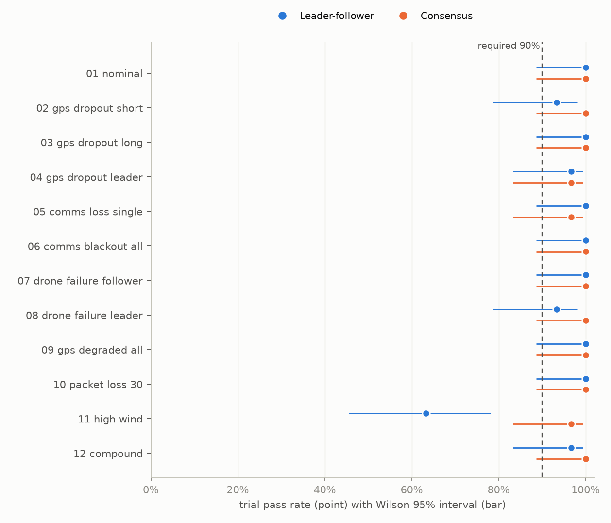
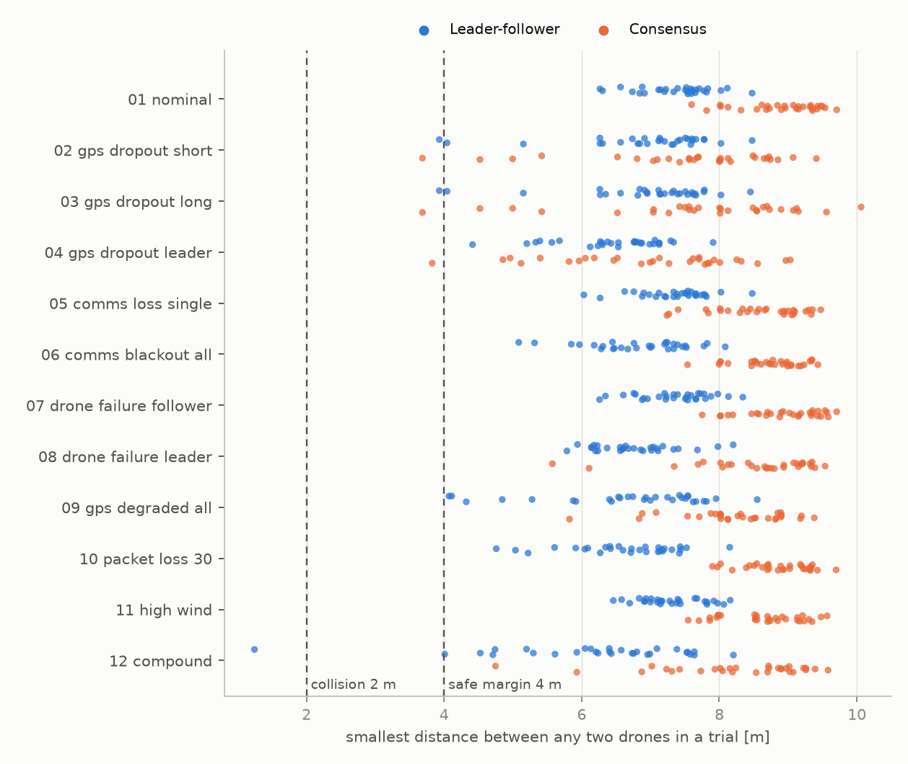
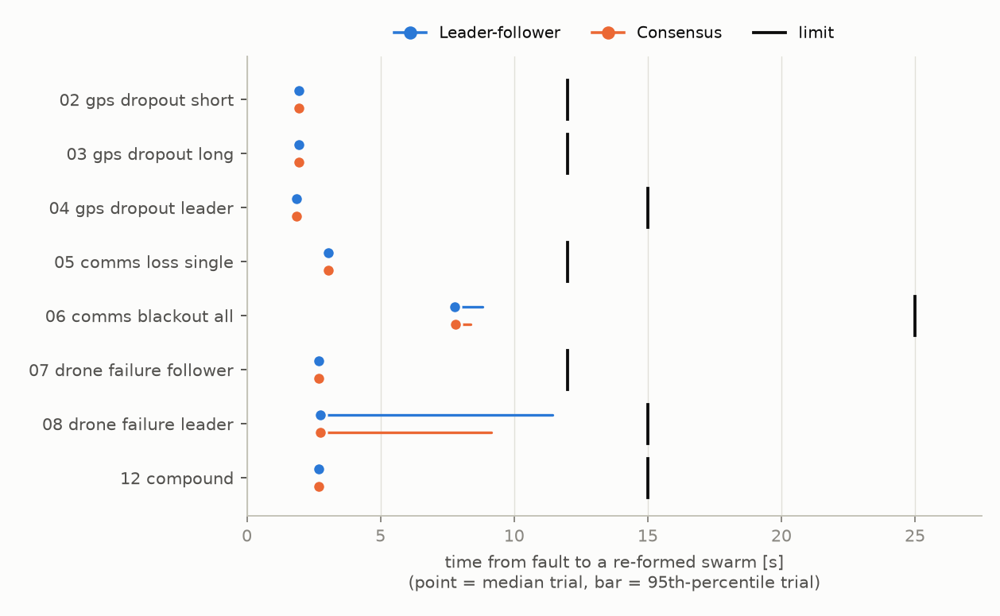
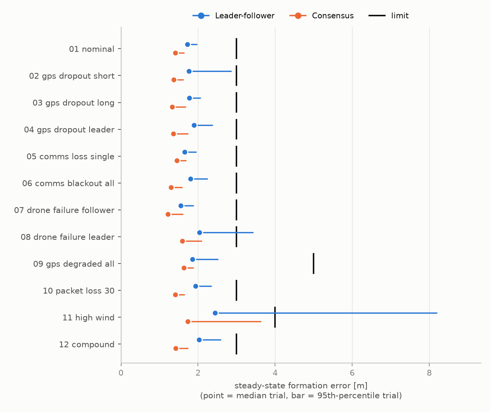
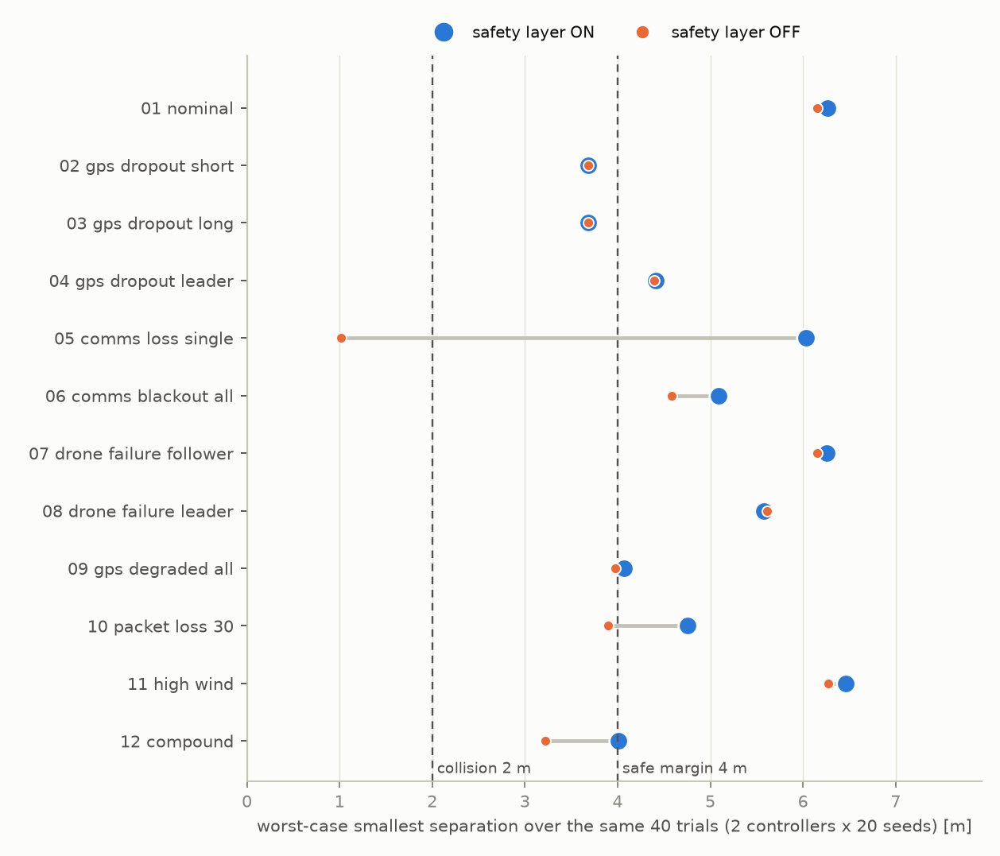
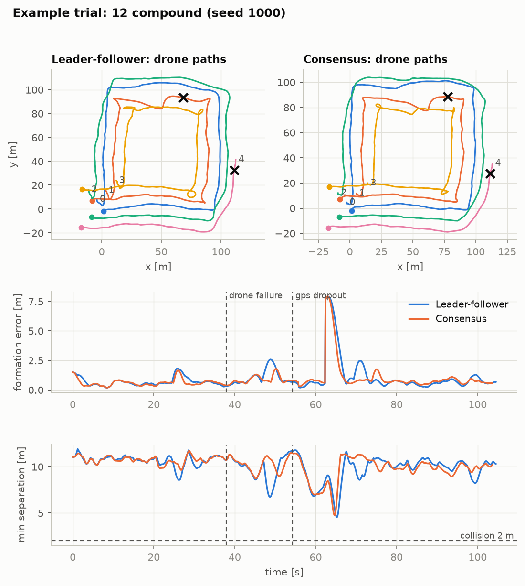

# SwarmSim: Test Report

Simulation-based assessment of two multi-UAV formation controllers under injected faults. Simulation only: no flight hardware, payload or operational capability.

## 1. Summary

- 23 of 24 scenario/controller combinations met the acceptance rule (trial pass rate at or above the required level).
- Leader-follower passed 343 of 360 trials overall (95.3%, Wilson 95% interval 92.6% to 97.0%).
- Consensus passed 357 of 360 trials overall (99.2%, Wilson 95% interval 97.6% to 99.7%).
- NOT ACCEPTED: 11 high wind with Leader-follower: 19/30 passed; failed criteria: steady_error_p95_m (11x).
- Individual failed trials inside accepted combinations: geofence breach: 04 gps dropout leader/Consensus x1, 04 gps dropout leader/Leader-follower x1; min separation m: 12 compound/Leader-follower x1; recovery time s: 05 comms loss single/Consensus x1, 08 drone failure leader/Leader-follower x1; steady error p95 m: 02 gps dropout short/Leader-follower x2, 08 drone failure leader/Leader-follower x2, 11 high wind/Consensus x1.
- Collisions (two drones closer than 2 m): 1 of 720 trials with the safety layer on.
- Controller differences larger than the statistical noise (non-overlapping 95% intervals): 11 high wind (Consensus better: 19/30 vs 29/30).
- Safety-layer ablation (same seeds, 480 trials each way): 469 passed with the layer on and 469 with it off; collisions 0 on vs 1 off; trials inside the 4 m margin 4 on vs 10 off.
- Scenarios where switching the layer off made the worst case clearly worse (more than 0.5 m): 05 comms loss single (worst separation 6.0 m with, 1.0 m without); 06 comms blackout all (worst separation 5.1 m with, 4.6 m without); 10 packet loss 30 (worst separation 4.8 m with, 3.9 m without); 12 compound (worst separation 4.0 m with, 3.2 m without). Elsewhere the layer changed the worst case by less than 0.5 m.
- False peer-loss alarms (heartbeat timeout with no fault involved): 0 of 720 trials.

## 2. Method

- 12 scenarios x 2 controllers x 30 seeded trials = 720 trials. Seeds are fixed, so every number is reproducible.
- Each trial flies a 5-drone wedge on a square mission (about 100 s) with wind, GPS noise, a lossy radio and a fault schedule. Fault onset times carry a seeded jitter.
- Acceptance criteria were written in `criteria/criteria.yaml` before the campaign. A trial passes when every applicable criterion passes; a combination is accepted when at least 90% of trials pass.
- Metrics are computed from ground truth, never from what a drone believes. On-board code only uses estimates and received messages.

## 3. Results

| Scenario | Controller | Pass | Rate [95% CI] | Verdict | Min sep [m] | Coll. | Detect p95 [s] | Recover p95 [s] | Steady err p95 [m] |
|---|---|---|---|---|---|---|---|---|---|
| 01 nominal | Consensus | 30/30 | 100% [89%-100%] | PASS | 7.60 | 0 | - | - | 1.63 |
| 01 nominal | Leader-follower | 30/30 | 100% [89%-100%] | PASS | 6.27 | 0 | - | - | 1.96 |
| 02 gps dropout short | Consensus | 30/30 | 100% [89%-100%] | PASS | 3.69 | 0 | 2.0 | 2.1 | 1.62 |
| 02 gps dropout short | Leader-follower | 28/30 | 93% [79%-98%] | PASS | 3.93 | 0 | 2.0 | 2.1 | 2.86 |
| 03 gps dropout long | Consensus | 30/30 | 100% [89%-100%] | PASS | 3.69 | 0 | 2.0 | 2.1 | 1.67 |
| 03 gps dropout long | Leader-follower | 30/30 | 100% [89%-100%] | PASS | 3.93 | 0 | 2.0 | 2.1 | 2.05 |
| 04 gps dropout leader | Consensus | 29/30 | 97% [83%-99%] | PASS | 3.83 | 0 | 1.9 | 2.1 | 1.73 |
| 04 gps dropout leader | Leader-follower | 29/30 | 97% [83%-99%] | PASS | 4.41 | 0 | 1.9 | 2.1 | 2.37 |
| 05 comms loss single | Consensus | 29/30 | 97% [83%-99%] | PASS | 7.24 | 0 | 2.8 | 3.1 | 1.68 |
| 05 comms loss single | Leader-follower | 30/30 | 100% [89%-100%] | PASS | 6.03 | 0 | 2.8 | 3.1 | 1.94 |
| 06 comms blackout all | Consensus | 30/30 | 100% [89%-100%] | PASS | 7.54 | 0 | 2.4 | 8.4 | 1.58 |
| 06 comms blackout all | Leader-follower | 30/30 | 100% [89%-100%] | PASS | 5.09 | 0 | 2.4 | 8.8 | 2.24 |
| 07 drone failure follower | Consensus | 30/30 | 100% [89%-100%] | PASS | 7.75 | 0 | 2.8 | 2.8 | 1.60 |
| 07 drone failure follower | Leader-follower | 30/30 | 100% [89%-100%] | PASS | 6.26 | 0 | 2.8 | 2.8 | 1.87 |
| 08 drone failure leader | Consensus | 30/30 | 100% [89%-100%] | PASS | 5.58 | 0 | 2.8 | 9.1 | 2.09 |
| 08 drone failure leader | Leader-follower | 28/30 | 93% [79%-98%] | PASS | 5.79 | 0 | 2.8 | 11.4 | 3.42 |
| 09 gps degraded all | Consensus | 30/30 | 100% [89%-100%] | PASS | 5.82 | 0 | - | - | 1.88 |
| 09 gps degraded all | Leader-follower | 30/30 | 100% [89%-100%] | PASS | 4.07 | 0 | - | - | 2.51 |
| 10 packet loss 30 | Consensus | 30/30 | 100% [89%-100%] | PASS | 7.90 | 0 | - | - | 1.64 |
| 10 packet loss 30 | Leader-follower | 30/30 | 100% [89%-100%] | PASS | 4.76 | 0 | - | - | 2.34 |
| 11 high wind | Consensus | 29/30 | 97% [83%-99%] | PASS | 7.55 | 0 | - | - | 3.62 |
| 11 high wind | Leader-follower | 19/30 | 63% [46%-78%] | FAIL | 6.46 | 0 | - | - | 8.19 |
| 12 compound | Consensus | 30/30 | 100% [89%-100%] | PASS | 4.75 | 0 | 2.7 | 2.8 | 1.73 |
| 12 compound | Leader-follower | 29/30 | 97% [83%-99%] | PASS | 1.24 | 1 | 2.7 | 2.8 | 2.58 |













## 4. Acceptance criteria applied

| Scenario | Criteria |
|---|---|
| 01 nominal | min_separation_m >= 2.0; time_below_safe_sep_s <= 1.0; steady_error_p95_m <= 3.0; formation_error_max_m <= 25.0; mission_complete = True; geofence_breach = False; false_peer_loss_events <= 0; survivors_at_end >= 5 |
| 02 gps dropout short | min_separation_m >= 2.0; time_below_safe_sep_s <= 1.0; steady_error_p95_m <= 3.0; formation_error_max_m <= 25.0; mission_complete = True; geofence_breach = False; detection_time_s <= 4.0; recovery_time_s <= 12.0; rejoin_time_s <= 30.0; survivors_at_end >= 5 |
| 03 gps dropout long | min_separation_m >= 2.0; time_below_safe_sep_s <= 1.0; steady_error_p95_m <= 3.0; formation_error_max_m <= 25.0; mission_complete = True; geofence_breach = False; detection_time_s <= 4.0; recovery_time_s <= 12.0; survivors_at_end >= 4 |
| 04 gps dropout leader | min_separation_m >= 2.0; time_below_safe_sep_s <= 1.0; steady_error_p95_m <= 3.0; formation_error_max_m <= 25.0; mission_complete = True; geofence_breach = False; detection_time_s <= 4.0; recovery_time_s <= 15.0; survivors_at_end >= 4 |
| 05 comms loss single | min_separation_m >= 2.0; time_below_safe_sep_s <= 1.0; steady_error_p95_m <= 3.0; formation_error_max_m <= 25.0; mission_complete = True; geofence_breach = False; detection_time_s <= 4.0; recovery_time_s <= 12.0; rejoin_time_s <= 30.0; survivors_at_end >= 5 |
| 06 comms blackout all | min_separation_m >= 2.0; time_below_safe_sep_s <= 1.0; steady_error_p95_m <= 3.0; formation_error_max_m <= 25.0; mission_complete = True; geofence_breach = False; detection_time_s <= 4.0; recovery_time_s <= 25.0; rejoin_time_s <= 30.0; survivors_at_end >= 5 |
| 07 drone failure follower | min_separation_m >= 2.0; time_below_safe_sep_s <= 1.0; steady_error_p95_m <= 3.0; formation_error_max_m <= 25.0; mission_complete = True; geofence_breach = False; detection_time_s <= 4.0; recovery_time_s <= 12.0; survivors_at_end >= 4 |
| 08 drone failure leader | min_separation_m >= 2.0; time_below_safe_sep_s <= 1.0; steady_error_p95_m <= 3.0; formation_error_max_m <= 25.0; mission_complete = True; geofence_breach = False; detection_time_s <= 4.0; recovery_time_s <= 15.0; survivors_at_end >= 4 |
| 09 gps degraded all | min_separation_m >= 2.0; time_below_safe_sep_s <= 1.0; steady_error_p95_m <= 5.0; formation_error_max_m <= 30.0; mission_complete = True; geofence_breach = False; false_peer_loss_events <= 0; survivors_at_end >= 5 |
| 10 packet loss 30 | min_separation_m >= 2.0; time_below_safe_sep_s <= 1.0; steady_error_p95_m <= 3.0; formation_error_max_m <= 25.0; mission_complete = True; geofence_breach = False; false_peer_loss_events <= 0; survivors_at_end >= 5 |
| 11 high wind | min_separation_m >= 2.0; time_below_safe_sep_s <= 1.0; steady_error_p95_m <= 4.0; formation_error_max_m <= 25.0; mission_complete = True; geofence_breach = False; false_peer_loss_events <= 0; survivors_at_end >= 5 |
| 12 compound | min_separation_m >= 2.0; time_below_safe_sep_s <= 1.0; steady_error_p95_m <= 3.0; formation_error_max_m <= 25.0; mission_complete = True; geofence_breach = False; detection_time_s <= 4.0; recovery_time_s <= 15.0; rejoin_time_s <= 30.0; survivors_at_end >= 4 |

## 5. Diagnostics after the campaign

Hand-written analysis of the campaign of 22 Oct 2026 (seeds 1000 to 1029). Not regenerated when the campaign is rerun.

- Strong wind, leader-follower (19 of 30 passed): the cause is airspeed headroom. A 3 to 5 m/s wind against a 4 m/s cruise speed needs about 7 to 9 m/s of air speed on upwind legs, at or above the 8 m/s vehicle limit. Rerunning the same 30 seeds with the limit raised to 12 m/s gives 30 of 30 for both controllers. Not fixed: slowing the mission to keep headroom would trade a formation failure for a mission-time failure.
- Geofence breach in the leader GPS-loss scenario (1 of 30 trials per controller): the drone that lost GPS drifted about 52 m on dead reckoning while landing and was outside the fence for 3 to 4 s at 3 to 4 m altitude. Not fixed.
- The single collision in 720 trials (compound scenario, leader-follower, 1.24 m): two healthy drones in formation, about 10 s after a GPS dropout ended. Cause not isolated.
- Safety layer: it changes the worst case clearly only where a neighbour goes silent (worst separation 6.0 m with it, 1.0 m without, in the single radio-loss scenario). Elsewhere total pass counts are identical with it on and off.

## 6. Limitations

- Simulation only. The vehicle is a point mass with a first-order velocity loop, an acceleration limit and a speed limit. It is not a rotor-level or attitude model and no real flight stack (PX4/ArduPilot) is in the loop.
- GPS, the radio and the wind are statistical models with the parameters listed in config.py. Real multipath, jamming, antenna patterns and terrain effects are not modelled.
- Results describe behaviour of this simulator under these faults. They are evidence for design decisions and a regression baseline, not a safety case or a guarantee about any physical system.
- Pass rates come from 30 trials per case, so a 100% rate still has a Wilson lower bound near 89%. The report therefore shows intervals, not only point values.
- Formation slots are fixed per drone: after a loss the formation keeps a gap instead of closing ranks. This was a deliberate choice to avoid slot swaps when a drone rejoins.
- Faults are injected one scenario at a time (plus one compound case). Common-cause failures and adversarial network behaviour are out of scope.
- The acceptance criteria were written before the campaign; two design parameters (heartbeat timeout, altitude layer in GPS failsafe) were changed after earlier small test runs exposed problems. The change history is in docs/DESIGN.md.

## 7. Reproducing this report

```
pip install -r requirements.txt
python -m swarmsim run --trials 30 --ablate --ablate-trials 20 --out results
python -m swarmsim report
python -m pytest tests -q
```

- Python 3.14.3, numpy 2.5.4, matplotlib 3.11.2
- Platform: Windows AMD64
- Generated: 2026-10-23 07:12
